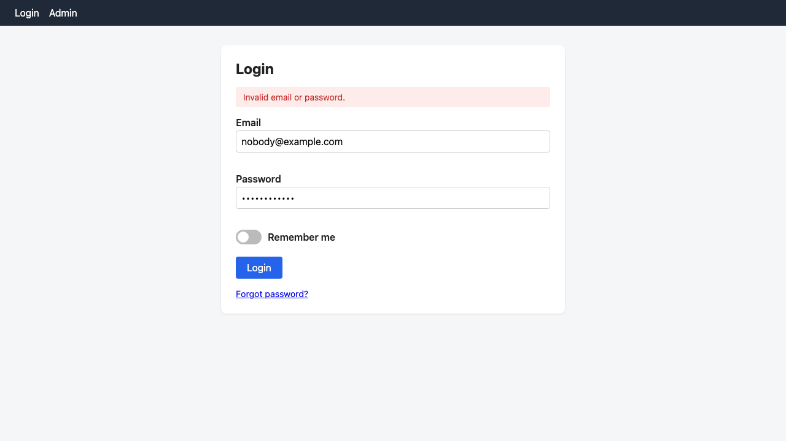

# Test Report

Run date: 2026-11-16 · Commit: `2e1e786` plus uncommitted changes (reporter config, docs) · Environment: macOS (Darwin 25.6.0), Node v24.15.0, Playwright 1.65.0, Chromium (headless) against `https://localhost:3443` (sandbox app, seeded database).

## 1. Result

| Run | Command | Tests | Passed | Failed | Skipped | Duration |
|---|---|---|---|---|---|---|
| **Main run** | `npx playwright test` | 68 | **68** | **0** | 0 | 5.9s |
| Stability run | `npx playwright test --repeat-each=3 --workers=4` | 202 | 202 | 0 | 0 | 15.6s |

**Verdict: all 68 tests pass, no failures, no flaky tests (retries are 0 locally; nothing was retried).** The stability run repeated every test 3 times in parallel and also passed in full. Static checks: `npm run lint` and `npm run typecheck` report no problems.

| Project | What it runs | Tests | Passed | Failed |
|---|---|---|---|---|
| setup | UI login that stores the session | 1 | 1 | 0 |
| chromium | UI tests (login, new test case) | 35 | 35 | 0 |
| api | API tests (auth, test cases) | 32 | 32 | 0 |

Plan coverage: TC-LOGIN-01 to 08 and TC-NTC-01 to 10 are executed (see [test-cases.md](test-cases.md)). API cases are not in the PDF; they were added on request.

## 2. Published results

| Artifact | Location | How to open |
|---|---|---|
| HTML report | [reports/html-report/](reports/html-report/index.html) | `npx playwright show-report docs/reports/html-report` |
| JUnit XML | [reports/junit.xml](reports/junit.xml) | any JUnit viewer or CI parser |
| Main run console log | [reports/main-run.log](reports/main-run.log) | text |
| Stability run console log | [reports/stability-run.log](reports/stability-run.log) | text |
| Failure demonstration | [reports/demo-failure/](reports/demo-failure/) and [reports/demo-failure-run.log](reports/demo-failure-run.log) | see section 4 |

The live report from a fresh run is generated in `reports/html` and `reports/junit.xml` (`npm run report` opens it). Publishing is local only; no CI or Allure is configured. Allure was not added: the HTML and JUnit reporters cover the need without extra dependencies (rules.md §5).

## 3. Evidence of passing tests

Passing tests produce no screenshots by design (`screenshot: 'only-on-failure'`). The evidence is the run logs, the JUnit file and the HTML report listed above. Each JUnit test case also records its `requirement` and faker `seed` properties, so any result can be reproduced with `FAKER_SEED=20260101 npx playwright test`.

Excerpt of the main run log (full file: [reports/main-run.log](reports/main-run.log)):

```
  ✓   4 [api] › tests/api/auth.api.spec.ts:13:3 › API: auth › API-AUTH-01: valid credentials return 200, a redirect and a secure session cookie (118ms)
  ✓  21 [api] › tests/api/test-cases.api.spec.ts:25:3 › API: test cases › API-TC-02: a valid test case is created and listed (145ms)
  ✓  38 [chromium] › tests/login/login.spec.ts:20:3 › Login › TC-LOGIN-01: successful login redirects to the dashboard @smoke (520ms)
  ✓  53 [chromium] › tests/test-case/new-test-case.spec.ts:17:3 › New Test Case › TC-NTC-01: create a test case with all fields and see it in the list @smoke (751ms)
...
  68 passed (5.9s)
```

Side effects: UI tests delete the test cases they create through the UI and API tests delete theirs by id. After the stability run the app's test-case table was empty (checked in the database).

## 4. Evidence of a failing test

**There were no failing tests in the final runs.** To show that failures are captured and easy to review, a throwaway spec with a deliberately wrong assertion was run once and then deleted (it is not part of the suite and not in the numbers above). Its log is [reports/demo-failure-run.log](reports/demo-failure-run.log).

- Test: login with an unknown user, then expect the error banner to read "This text is deliberately wrong".
- Result: ❌ failed (first attempt and retry), after the 5 s assertion timeout.
- Message: `Expected: "This text is deliberately wrong"` / `Received: "Invalid email or password."` with the locator `getByTestId('login-error')` and the call log.

| Evidence | File |
|---|---|
| Screenshot at failure | [reports/demo-failure/screenshot.png](reports/demo-failure/screenshot.png) |
| Video of the test | [reports/demo-failure/video.webm](reports/demo-failure/video.webm) |
| Trace (retry, `trace: 'on-first-retry'`) | [reports/demo-failure/trace.zip](reports/demo-failure/trace.zip), open with `npx playwright show-trace` |
| Page snapshot (error context) | [reports/demo-failure/error-context.md](reports/demo-failure/error-context.md) |



## 5. Per-test results

Source: [reports/junit.xml](reports/junit.xml).

### Setup (1)
| # | Test | Result | Time (s) |
|---|---|---|---|
| 1 | authenticate as the standard user through the UI | ✅ passed | 0.50 |

### UI tests (35)
| # | Test | Result | Time (s) |
|---|---|---|---|
| 1 | Login › TC-LOGIN-01: successful login redirects to the dashboard @smoke | ✅ passed | 0.52 |
| 2 | Login › TC-LOGIN-02: invalid credentials show an error › unknown user | ✅ passed | 0.56 |
| 3 | Login › TC-LOGIN-02: invalid credentials show an error › valid email with a wrong password | ✅ passed | 0.60 |
| 4 | Login › TC-LOGIN-03: empty fields trigger frontend validation and no backend call › both empty | ✅ passed | 0.46 |
| 5 | Login › TC-LOGIN-03: empty fields trigger frontend validation and no backend call › email only | ✅ passed | 0.53 |
| 6 | Login › TC-LOGIN-03: empty fields trigger frontend validation and no backend call › password only | ✅ passed | 0.29 |
| 7 | Login › TC-LOGIN-04: invalid email formats are rejected › rejects "plainaddress" | ✅ passed | 0.31 |
| 8 | Login › TC-LOGIN-04: invalid email formats are rejected › rejects "user@" | ✅ passed | 0.31 |
| 9 | Login › TC-LOGIN-04: invalid email formats are rejected › rejects "@domain.com" | ✅ passed | 0.28 |
| 10 | Login › TC-LOGIN-04: invalid email formats are rejected › rejects "user@domain" | ✅ passed | 0.32 |
| 11 | Login › TC-LOGIN-04: invalid email formats are rejected › rejects "user name@domain.com" | ✅ passed | 0.30 |
| 12 | Login › TC-LOGIN-05: password is masked and the page is served over HTTPS @smoke | ✅ passed | 0.27 |
| 13 | Login › TC-LOGIN-06: Remember me › is off by default | ✅ passed | 0.24 |
| 14 | Login › TC-LOGIN-06: Remember me › ON keeps a persistent session cookie | ✅ passed | 0.49 |
| 15 | Login › TC-LOGIN-06: Remember me › OFF issues a browser-session cookie | ✅ passed | 0.43 |
| 16 | Login › TC-LOGIN-07: navigation links › Forgot Password link opens the forgot password page | ✅ passed | 0.40 |
| 17 | Login › TC-LOGIN-07: navigation links › Admin link in the top menu opens the admin login page | ✅ passed | 0.35 |
| 18 | Login › TC-LOGIN-07: navigation links › Login link in the top menu leads to the login page | ✅ passed | 0.43 |
| 19 | Login › TC-LOGIN-08: labels, placeholders and Remember me are visible | ✅ passed | 0.25 |
| 20 | New Test Case › TC-NTC-01: create a test case with all fields and see it in the list @smoke | ✅ passed | 0.75 |
| 21 | New Test Case › TC-NTC-02: create a test case with required fields only @smoke | ✅ passed | 0.59 |
| 22 | New Test Case › TC-NTC-03: required fields empty show errors and nothing is saved › empty Title | ✅ passed | 0.64 |
| 23 | New Test Case › TC-NTC-03: required fields empty show errors and nothing is saved › empty Expected Result | ✅ passed | 0.55 |
| 24 | New Test Case › TC-NTC-03: required fields empty show errors and nothing is saved › empty Title and Expected Result | ✅ passed | 0.65 |
| 25 | New Test Case › TC-NTC-03: required fields empty show errors and nothing is saved › all required fields empty | ✅ passed | 0.38 |
| 26 | New Test Case › TC-NTC-04: at least one test step is required | ✅ passed | 0.41 |
| 27 | New Test Case › TC-NTC-05: multiple steps keep their order @smoke | ✅ passed | 0.66 |
| 28 | New Test Case › TC-NTC-06: Automated toggle › is off by default and saves as not automated | ✅ passed | 0.63 |
| 29 | New Test Case › TC-NTC-06: Automated toggle › saves as automated when turned on | ✅ passed | 0.60 |
| 30 | New Test Case › TC-NTC-07: Enter key › does not submit an invalid form from the Title field | ✅ passed | 0.37 |
| 31 | New Test Case › TC-NTC-07: Enter key › does not submit an invalid form from a step field | ✅ passed | 0.36 |
| 32 | New Test Case › TC-NTC-07: Enter key › submits a fully valid form (observed behaviour) | ✅ passed | 0.48 |
| 33 | New Test Case › TC-NTC-08: back arrow returns to the list without saving | ✅ passed | 0.31 |
| 34 | New Test Case › TC-NTC-09: placeholders are correct | ✅ passed | 0.24 |
| 35 | New Test Case › TC-NTC-10: all created test cases are listed @smoke | ✅ passed | 0.88 |

### API tests (32)
| # | Test | Result | Time (s) |
|---|---|---|---|
| 1 | API: auth › API-AUTH-01: valid credentials return 200, a redirect and a secure session cookie | ✅ passed | 0.12 |
| 2 | API: auth › API-AUTH-02: Remember me ON gives a persistent cookie, OFF a session cookie | ✅ passed | 0.16 |
| 3 | API: auth › API-AUTH-03: invalid credentials are refused with 401 › unknown user | ✅ passed | 0.18 |
| 4 | API: auth › API-AUTH-03: invalid credentials are refused with 401 › valid email with a wrong password | ✅ passed | 0.18 |
| 5 | API: auth › API-AUTH-04: invalid login payloads are rejected with 400 › email "plainaddress" | ✅ passed | 0.06 |
| 6 | API: auth › API-AUTH-04: invalid login payloads are rejected with 400 › email "user@" | ✅ passed | 0.03 |
| 7 | API: auth › API-AUTH-04: invalid login payloads are rejected with 400 › email "@domain.com" | ✅ passed | 0.01 |
| 8 | API: auth › API-AUTH-04: invalid login payloads are rejected with 400 › email "user@domain" | ✅ passed | 0.01 |
| 9 | API: auth › API-AUTH-04: invalid login payloads are rejected with 400 › email "user name@domain.com" | ✅ passed | 0.01 |
| 10 | API: auth › API-AUTH-04: invalid login payloads are rejected with 400 › missing email | ✅ passed | 0.01 |
| 11 | API: auth › API-AUTH-04: invalid login payloads are rejected with 400 › empty password | ✅ passed | 0.01 |
| 12 | API: auth › API-AUTH-05: admin login › accepts an admin account | ✅ passed | 0.08 |
| 13 | API: auth › API-AUTH-05: admin login › refuses a normal user | ✅ passed | 0.04 |
| 14 | API: auth › API-AUTH-06: current user › returns 401 when logged out | ✅ passed | 0.07 |
| 15 | API: auth › API-AUTH-06: current user › returns email and role when logged in | ✅ passed | 0.13 |
| 16 | API: auth › API-AUTH-07: logout invalidates the session | ✅ passed | 0.11 |
| 17 | API: auth › API-AUTH-08: forgot password › answers identically for a known and an unknown email | ✅ passed | 0.07 |
| 18 | API: auth › API-AUTH-08: forgot password › rejects an invalid email | ✅ passed | 0.06 |
| 19 | API: test cases › API-TC-01: all endpoints return 401 when logged out | ✅ passed | 0.15 |
| 20 | API: test cases › API-TC-02: a valid test case is created and listed | ✅ passed | 0.14 |
| 21 | API: test cases › API-TC-03: invalid payloads are rejected with 400 and not saved › missing title | ✅ passed | 0.15 |
| 22 | API: test cases › API-TC-03: invalid payloads are rejected with 400 and not saved › blank title | ✅ passed | 0.15 |
| 23 | API: test cases › API-TC-03: invalid payloads are rejected with 400 and not saved › missing expected result | ✅ passed | 0.14 |
| 24 | API: test cases › API-TC-03: invalid payloads are rejected with 400 and not saved › blank expected result | ✅ passed | 0.14 |
| 25 | API: test cases › API-TC-03: invalid payloads are rejected with 400 and not saved › missing steps | ✅ passed | 0.14 |
| 26 | API: test cases › API-TC-03: invalid payloads are rejected with 400 and not saved › empty steps list | ✅ passed | 0.13 |
| 27 | API: test cases › API-TC-03: invalid payloads are rejected with 400 and not saved › only blank steps | ✅ passed | 0.07 |
| 28 | API: test cases › API-TC-03: invalid payloads are rejected with 400 and not saved › steps is not a list | ✅ passed | 0.14 |
| 29 | API: test cases › API-TC-03: invalid payloads are rejected with 400 and not saved › everything missing | ✅ passed | 0.14 |
| 30 | API: test cases › API-TC-04: optional fields default and blank steps are dropped | ✅ passed | 0.14 |
| 31 | API: test cases › API-TC-05: delete › removes the test case from the list | ✅ passed | 0.14 |
| 32 | API: test cases › API-TC-05: delete › deleting an unknown id still returns 200 (observed behaviour) | ✅ passed | 0.04 |

Slowest tests: TC-NTC-10: all created test cases are listed @smoke (0.88s); TC-NTC-01: create a test case with all fields and see it in the list @smoke (0.75s); TC-NTC-05: multiple steps keep their order @smoke (0.66s); empty Title and Expected Result (0.65s); empty Title (0.64s).

## 6. Reproduce

```bash
cd sandbox-app && npm start          # or let Playwright start it
npm test                             # all projects
npm run report                       # open reports/html
```
